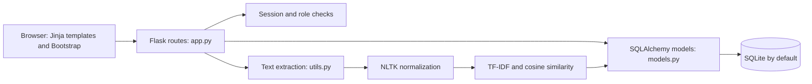

# Document Similarity Detector

A Flask web app that compares uploaded documents with documents already stored in its database. It extracts text from TXT, PDF, and DOCX files, normalizes English text with NLTK, and scores each pair with TF-IDF cosine similarity. It is a similarity aid, not proof of plagiarism.

## Features

- Student registration and login with hashed passwords.
- TXT, PDF, and DOCX uploads, limited to 16 MB.
- SHA-256 hash of extracted text to reject exact duplicate content.
- Similarity reports for pairs with a score above zero.
- Student report view for their own uploads and an admin view across uploads.
- SQLite storage by default; SQLAlchemy models and relationships.

## Architecture



The app is a single Flask process. `app.py` handles requests, authentication, uploads, and report generation. `plagiarism_detector/utils.py` extracts and compares text. `plagiarism_detector/models.py` defines the ORM tables and database engine. `config.py` holds environment settings. `templates/` renders pages; `static/` holds CSS.

### Data model

| Table | Purpose | Main relationships |
| --- | --- | --- |
| `users` | Account, password hash, and `student` or `admin` role | One user uploads many documents and can generate reports |
| `documents` | Filename, extracted text, SHA-256 content hash, type, upload time | Belongs to an uploader; participates in reports |
| `similarity_reports` | Score, details, timestamp | Links the new document to one existing document and a generating user |

### Upload and comparison flow

1. A logged-in user uploads a supported file. The server saves it temporarily in `uploads/`.
2. The extractor reads its text. Empty text is rejected. A SHA-256 hash of the raw extracted text checks for exact duplicates.
3. The app stores the document, then normalizes its text: lowercase, punctuation cleanup, tokenization, English stopword removal, and lemmatization.
4. It compares the new document with every other stored document. A fresh TF-IDF model fits each pair, then cosine similarity produces a score from 0 to 1.
5. Scores above zero become `similarity_reports` rows. The temporary upload is removed; extracted text remains in the database.

Comparison runs synchronously during the upload request and scans all existing documents. It may become slow as the database grows. A saved document can have no reports if no terms overlap or if comparison fails.

## Run locally

Requires Python 3.10+ and internet access on first run for NLTK corpus downloads. From this project directory, in PowerShell:

```powershell
py -m venv .venv
.\.venv\Scripts\Activate.ps1
python -m pip install -r requirements.txt
$env:SECRET_KEY = 'replace-with-a-long-random-secret'
python app.py
```

Open `http://127.0.0.1:5000`. Register a student account, log in, and upload a document. Upload a second document to generate comparisons. SQLite tables and `plagiarism_detector.db` are created automatically in the project root. If NLTK downloads fail, run `python -m nltk.downloader stopwords punkt wordnet omw-1.4` and restart.

### Configuration

| Variable | Meaning |
| --- | --- |
| `SECRET_KEY` | Flask session signing key. Set a strong value before sharing or deploying the app. |
| `DATABASE_URL` | SQLAlchemy URL. Defaults to `sqlite:///` plus the project path and `plagiarism_detector.db`. |
| `FLASK_CONFIG` | `dev` (default), `test`, or `prod`. Use `prod` to disable Flask debug mode. |
| `TEST_DATABASE_URL` | Defined for test configuration in `config.py`. The current engine reads the base `Config` class, so this variable does **not** change its database connection. |

The app uses SQLAlchemy directly, not Flask-SQLAlchemy. `create_all()` creates missing tables but does not migrate existing schemas. Non-SQLite database URLs need their corresponding Python driver installed separately.

## Routes

| Route | Purpose |
| --- | --- |
| `/` | List uploaded document metadata |
| `/register`, `/login`, `/logout` | Account and session actions |
| `/upload` | Upload and compare a document; login required |
| `/document/<id>` | View text and reports; uploader or admin only |
| `/reports` | Student's own generated reports, or all reports for admin |
| `/admin/users` | Admin user listing; edit and delete buttons are placeholders |

Public registration creates students only. There is no admin creation interface. An admin must be created or promoted through a trusted database operation.

## Project layout

```text
app.py                         Flask routes and comparison workflow
config.py                      Runtime configuration
plagiarism_detector/models.py  SQLAlchemy tables and engine
plagiarism_detector/utils.py   Extraction, normalization, scoring
templates/                     Jinja pages
static/css/style.css           Custom styles
requirements.txt               Python dependencies
uploads/                       Temporary upload directory (ignored)
plagiarism_detector.db         Local database (ignored)
```

## Current limits and security notes

- The home page lists all document filenames and uploader names, including to visitors. Document text is restricted by the document route.
- Report pages can link to a comparison document that the student cannot open unless they uploaded it.
- Forms have no CSRF protection. The fallback `SECRET_KEY` in `config.py` is public; override it through the environment.
- The built-in Flask server is for local development. Production hosting needs a production WSGI server and additional security review.
- Similarity uses English preprocessing and whole-document word overlap. It does not identify copied passages, paraphrases, or authorship.
- No automated test suite or database migrations are included.

## Publishing

This folder currently sits under a Git repository rooted at `D:\`. Do not run `git add .` from that root. Create a separate repository for this project before pushing:

```powershell
cd 'D:\UET LAHORE\4th Semester\ADVANCE-DBMS -LAB\project'
git init
git add README.md .gitignore app.py config.py requirements.txt plagiarism_detector templates static
git status --short
git commit -m "Initial project documentation and source"
git branch -M main
git remote add origin https://github.com/YOUR_USERNAME/document-similarity-detector.git
git push -u origin main
```

Check `git status --short` before committing. Never commit the local database, uploads, or secrets. If Git reports an existing nested repository, inspect its root before adding files.
